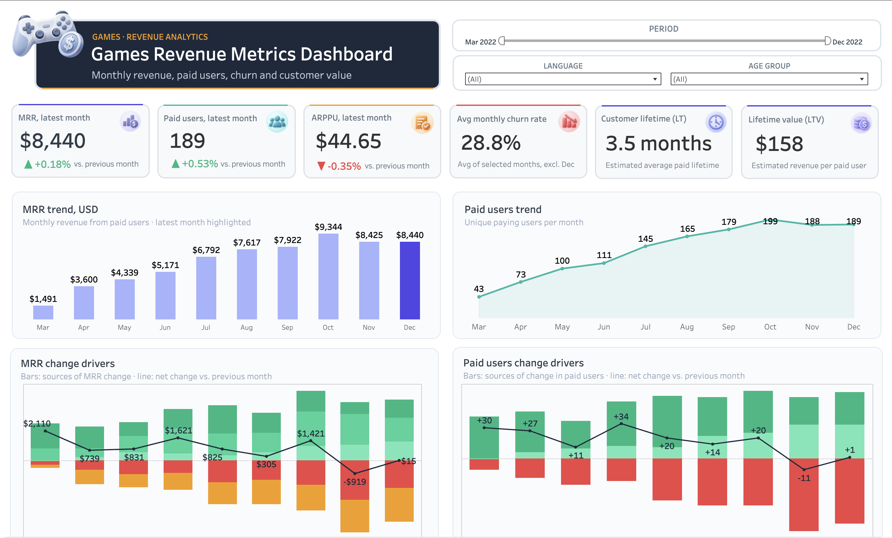
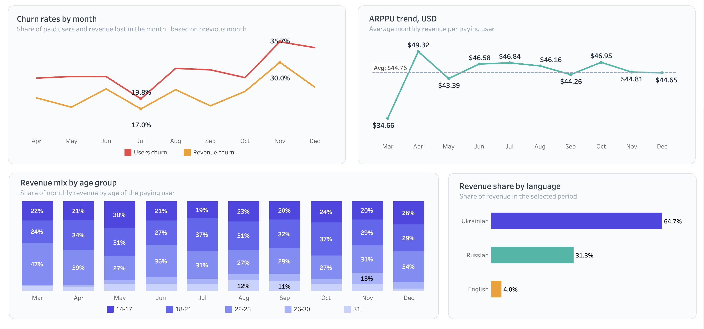

# Games Revenue Metrics: SQL + Tableau

End-to-end revenue analytics for a games product: from raw payments in PostgreSQL to an interactive Tableau dashboard.

**📊 Dashboard (Tableau Public):** [https://public.tableau.com/views/GamesRevenueMetricsMRRChurnLTV/Dashboard1?:language=en-US&:sid=&:display_count=n&:origin=viz_share_link]

## Goal

Help product managers see not only how much revenue the product makes, but **why it changes month to month**: how many users are new, how many churn or come back, and how existing users change their spending.

## Data

Schema `project` in PostgreSQL, period March–December 2022.

| Table | Content |
|---|---|
| `games_payments` | one row per payment: `user_id`, `game_name`, `payment_date`, `revenue_amount_usd` |
| `games_paid_users` | one row per user: `user_id`, `game_name`, `language`, `has_older_device_model`, `age` |

## Approach

The query in [`sql/revenue_metrics.sql`](sql/revenue_metrics.sql) uses four CTEs. Final grain: **one row per user and month**.

1. `monthly_revenue`: payments aggregated to user × month.
2. `payment_history`: `LAG` / `LEAD` give the previous and next month the user actually paid. They are compared with the calendar month.
3. `user_month_metrics`: every user-month gets labels: `new`, `churned`, `expansion`, `contraction`, `returned`.
4. `users`: one row per `user_id` (language, age, device), joined with `LEFT JOIN` so no payments are lost.

Ratios (MRR, ARPPU, churn rate, LT, LTV) are calculated in **Tableau**, so they respond to the language and age filters.

## Metric logic

| Metric | Definition |
|---|---|
| MRR | sum of revenue in a calendar month |
| Paid users | unique users who paid in the month |
| New | no previous paid month |
| Churned | paid in month *t*, did not pay in *t+1* |
| Returned | paid before, skipped at least one month, paid again |
| Expansion / Contraction | change in spend vs. the previous calendar month, for users who paid in both |
| Churn rate | churned users / paid users of the previous month |
| LT | 1 / average monthly churn rate |
| LTV | average monthly ARPPU × LT |

**Validation.** Every month: `MRR(t) − MRR(t−1) = new + expansion + contraction + returned − churned revenue`. This reconciled to zero only after the `returned` category was added. The same balance holds for paid users.

## Key findings

- MRR grew from $1.5K to a peak of $9.3K in October, then flattened around $8.4K.
- In November, new users brought $863, while churn took $2,800 and contraction $2,291. Expansion and returning users softened the net change to −$919.
- New paid users fell from 41 (Oct) to 27 (Nov). 35.7% of October's payers did not pay in November.
- ARPPU stayed within $43–47: growth came from the number of payers, not a bigger average check.
- Revenue churn (30.0%) is lower than user churn (35.7%) in November: the users who leave pay less.

## Hypotheses to test next

- Part of the churn may be a pause: 346 churn events vs. 152 returns. Recalculate churn with a 2-month grace period.
- Cohort retention: when exactly do users leave?
- Russian-speaking users fell from 44% to 28% of revenue, with slightly higher churn. Acquisition or retention?
- A win-back offer for lapsed payers: 33 users returned in both November and December.

## Limitations

- One year of data: findings are ideas to test, not conclusions.
- The last month (December) is excluded from churn, because the next month is not in the data.
- Small segments (English: 8 paying users; ages 26+) give unstable LT and LTV.
- The date `2022-12-01` is hard-coded in three Tableau formulas (average churn, ARPPU and the latest month).

## Tools

PostgreSQL (CTEs, window functions) · DBeaver · Tableau Public
